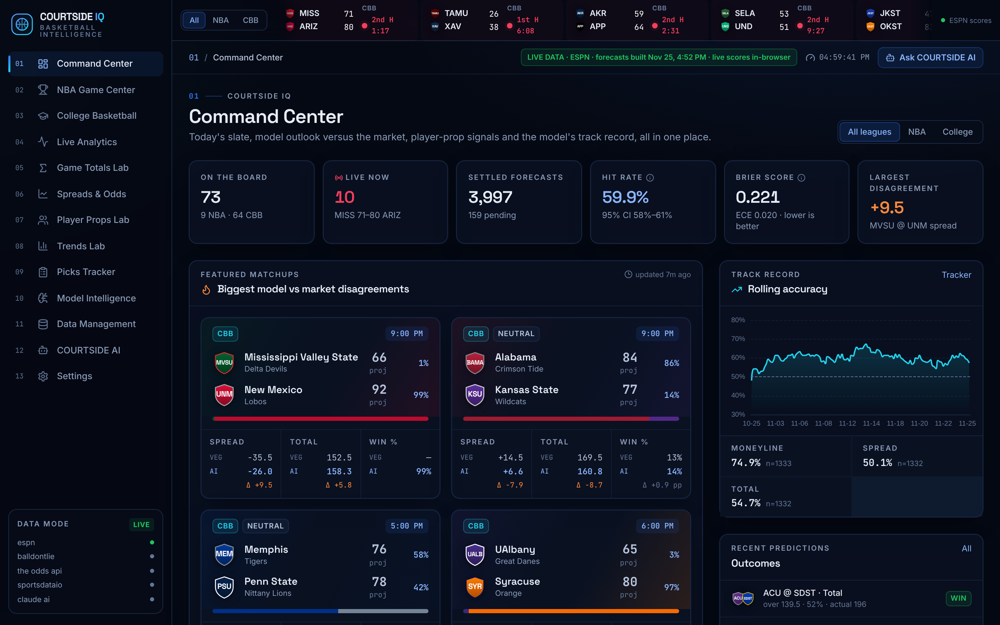
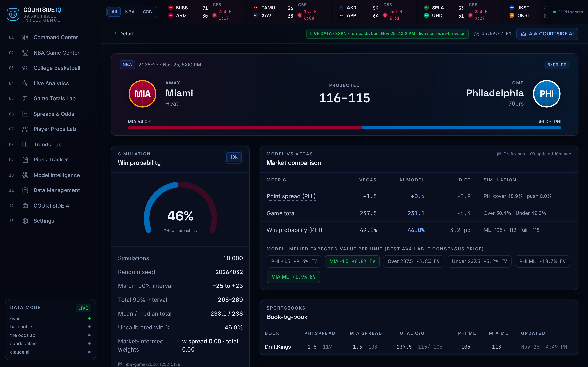
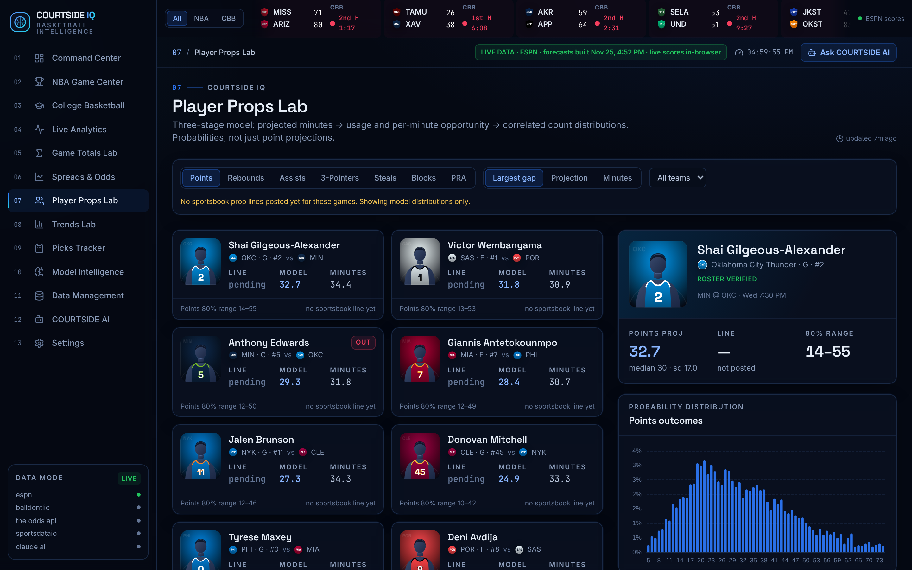
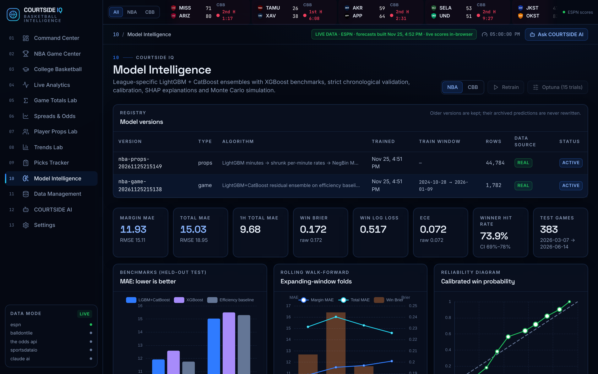
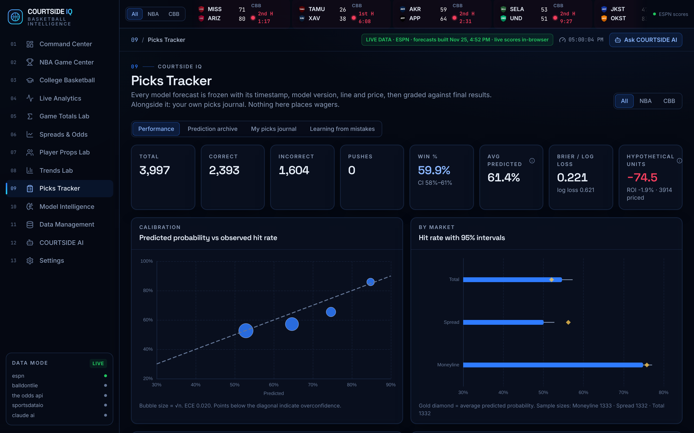
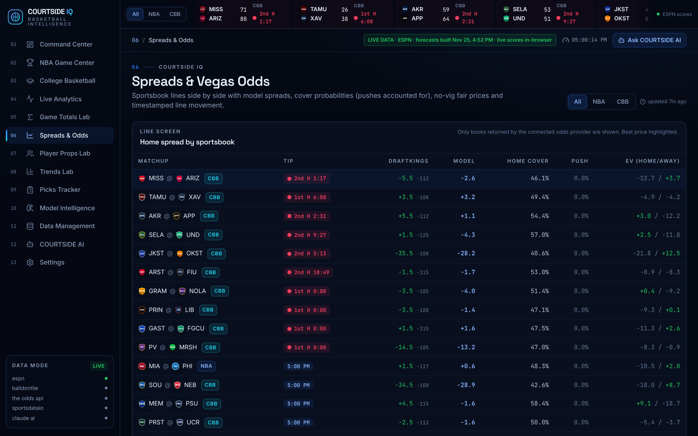
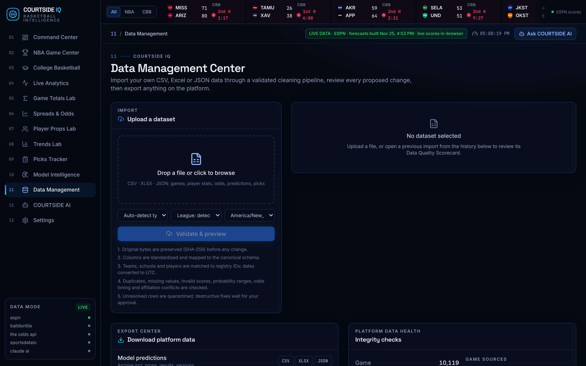
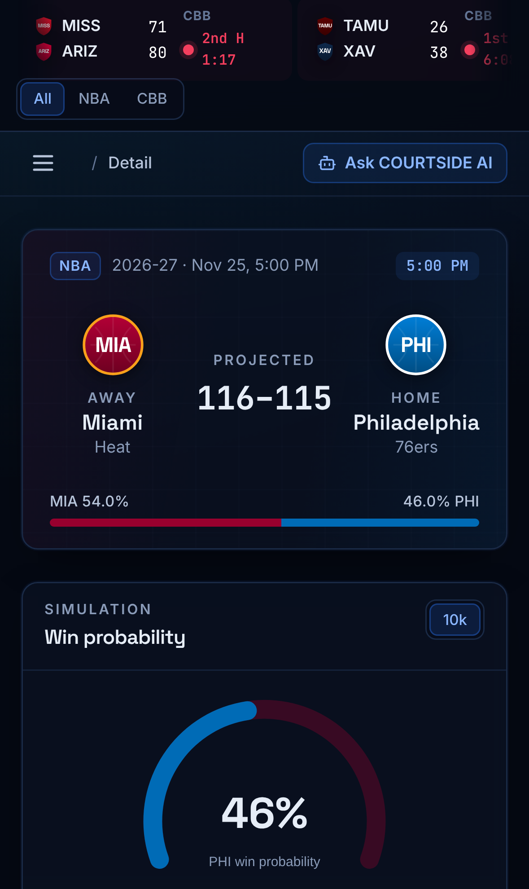

# COURTSIDE IQ

[](https://github.com/krisfigueiredo-ui/courtside-iq/actions/workflows/ci.yml)
[](https://krisfigueiredo-ui.github.io/courtside-iq/)


**Live site: https://krisfigueiredo-ui.github.io/courtside-iq/** (real games, rebuilt every two hours, live scores in the browser)

Basketball analytics platform for the NBA and NCAA Division I men's basketball, running on real data: schedules, live scores, final scores, team and player box scores, DraftKings opening and closing lines, the NBA injury report and NBA rosters from ESPN's public API. It combines a live scoreboard, league-specific machine-learning projections, Monte Carlo simulation, sportsbook market comparison, player prop distributions, a trends lab, a permanent prediction archive with automated grading, a data import and cleaning pipeline, and an AI research assistant that answers questions from the platform's own records.



> COURTSIDE IQ is research and analysis software. Forecasts are probability estimates and are not betting or financial advice. The application never places wagers.

## Contents

- [Features](#features)
- [Screenshots](#screenshots)
- [Architecture](#architecture)
- [Getting started](#getting-started)
- [Configuration](#configuration)
- [Data](#data)
- [Modeling](#modeling)
- [Prediction archive and grading](#prediction-archive-and-grading)
- [Data management](#data-management)
- [COURTSIDE AI](#courtside-ai)
- [Testing](#testing)
- [Deployment](#deployment)
- [Limitations](#limitations)

## Features

| Area | Highlights |
|---|---|
| Command Center | Live ticker (Server-Sent Events), featured matchups, model vs market outlook, prop signals, rolling accuracy |
| NBA and College centers | Slates, schedules, efficiency standings, team directories by conference, rosters |
| Live Analytics | Game state, pace vs projection, in-game win probability and projected totals |
| Game Totals Lab | Estimated possessions, simulated score distributions, first-half and team totals |
| Spreads and Odds | Book-by-book line screen, cover and push probabilities, alternate-line ladder, line movement, no-vig calculator |
| Player Props Lab | Minutes model, per-stat probability distributions, correlation between stats, prop history |
| Trends Lab | Team and player rolling windows with sample sizes, splits, ATS and over/under history, heatmaps, correlation matrix |
| Picks Tracker | Permanent forecast archive, calibration, accuracy by market/team/player/conference, closing line value, personal picks journal, error diagnostics |
| Model Intelligence | Version registry and comparison, held-out metrics, benchmarks, walk-forward and season-by-season backtests, SHAP explanations, Optuna tuning, simulation explorer |
| Data Management | CSV/XLSX/JSON import with validation, quarantine and approval; formatted exports |
| COURTSIDE AI | Claude-based assistant with read-only database tools, semantic retrieval and record citations |

## Screenshots

| Game detail | Player props |
|---|---|
|  |  |
| **Model Intelligence** | **Picks Tracker** |
|  |  |
| **Spreads and odds** | **Data Management** |
|  |  |



## Architecture

```
courtside-iq/
├── backend/                 FastAPI service (Python 3.12+)
│   ├── app/
│   │   ├── models.py        SQLAlchemy schema (26 tables)
│   │   ├── registry/        NBA franchises, NCAA schools and conferences, NBA seed roster
│   │   ├── providers/       ESPN client and sync (default); BALLDONTLIE and The Odds API clients
│   │   ├── ml/              Point-in-time features, game model, props model, simulator, metrics
│   │   ├── services/        Modeling, market math, settlement, performance, trends, diagnostics
│   │   ├── data_mgmt/       Import pipeline, exports, dataset snapshots
│   │   ├── ai/              Retrieval (pgvector), read-only tools, Claude tool-use loop
│   │   ├── api/routes.py    REST API and SSE ticker
│   │   ├── scheduler.py     Data refresh, forecast archiving, settlement
│   │   ├── static_export.py Static preview data export
│   │   └── cli.py           Operations CLI
│   ├── alembic/             Database migrations
│   ├── data/espn_snapshot/  Committed real dataset (gzipped CSV + manifest)
│   ├── data/demo_snapshot/  Synthetic dataset used by the test suite
│   └── tests/               Backend test suite
├── frontend/                Next.js 15, TypeScript, Tailwind, Radix UI, Framer Motion, ECharts, TanStack
├── docs/                    Deployment guide, dataset reference, screenshots
├── .github/workflows/       CI and GitHub Pages preview deployment
└── docker-compose.yml       PostgreSQL + pgvector, Redis, API, worker, web
```

| Layer | Technology |
|---|---|
| API | FastAPI, SQLAlchemy 2, Alembic, Pydantic |
| Storage | PostgreSQL 16 with pgvector (SQLite supported for development), Redis cache |
| Modeling | LightGBM, CatBoost, XGBoost (benchmark), scikit-learn, SHAP, Optuna, NumPy, pandas, SciPy |
| AI | Anthropic Claude API, pgvector retrieval |
| Frontend | Next.js, React 19, Tailwind CSS, Radix UI, Framer Motion, Apache ECharts, Recharts, TanStack Query and Table |
| Delivery | Docker, GitHub Actions |

## Getting started

### Live site

https://krisfigueiredo-ui.github.io/courtside-iq/ is rebuilt by `.github/workflows/pages.yml` on every push to `main` and every two hours. Each build restores the committed real-data snapshot, syncs everything since then from ESPN, retrains the models, re-runs the walk-forward backtest and freezes forecasts for upcoming games. Between builds the browser refreshes the score, period and clock of games in progress directly from ESPN. Features that write data (picks, imports, retraining) and the AI assistant require the full application.

### Docker

```bash
git clone https://github.com/krisfigueiredo-ui/courtside-iq.git
cd courtside-iq
cp .env.example .env
docker compose up --build
```

- Web: http://localhost:3000
- API documentation: http://localhost:8000/docs

On first start the API restores the committed real-data snapshot, syncs the days since it was taken from ESPN, trains both leagues' models and builds the prediction archive. This takes about two minutes. No API key is needed.

### Local development

Requirements: Python 3.12+, Node.js 22.

```bash
make install        # Python virtualenv + npm dependencies
make api            # http://localhost:8000 (SQLite by default)
make web            # http://localhost:3000 (second terminal)
```

Run `make help` for all targets.

## Configuration

Settings are read from environment variables (see `.env.example`). API keys are used only by the server and are never sent to the browser.

| Variable | Purpose |
|---|---|
| `DATABASE_URL` | SQLAlchemy URL. Default `sqlite:///./courtside.db` |
| `REDIS_URL` | Optional provider response cache |
| `DATA_SOURCE` | `espn` (default): real data from ESPN's public API, no key. `demo`: the synthetic dataset |
| `ESPN_SEASONS_NBA`, `ESPN_SEASONS_CBB` | Seasons of history to load on first run (default 3 and 2) |
| `ESPN_POLL_SECONDS` | Live refresh interval for scores and lines (default 60) |
| `BALLDONTLIE_API_KEY` | Optional alternative feed for games, box scores, rosters, injuries |
| `ODDS_API_KEY` | Optional: player prop lines, first-half and team totals, more sportsbooks (The Odds API v4) |
| `SPORTSDATAIO_API_KEY` | Health checks only; endpoint mapping depends on the subscription |
| `ANTHROPIC_API_KEY`, `ANTHROPIC_MODEL`, `AI_EFFORT` | COURTSIDE AI |
| `LICENSED_LOGO_BASE_URL` | Base URL of a licensed logo CDN (`{slug}.svg`) |
| `LIVE_POLL_SECONDS`, `ODDS_POLL_SECONDS` | Refresh cadence |
| `MONTE_CARLO_SIMS`, `RANDOM_SEED` | Simulation size and reproducibility |
| `USE_DEMO_SNAPSHOT` | With `DATA_SOURCE=demo`, load the committed synthetic dataset (default `true`) |
| `ADMIN_TOKEN` | Protects retrain, tune, refresh and asset registration endpoints |
| `MLFLOW_TRACKING_URI` | Optional experiment tracking |

### Data sources

With `DATA_SOURCE=espn` (the default) the scheduler:

- refreshes scores, game status and DraftKings lines for yesterday, today and tomorrow every minute, and the next seven days of schedule every hour
- loads team and player box scores for each game as it goes final
- refreshes the NBA injury report every 30 minutes and records each upcoming game's injury impact
- verifies NBA rosters against ESPN every six hours
- freezes pre-game forecasts and grades them after the final

With `ODDS_API_KEY` set it also pulls first-half totals, team totals, alternate lines and player props for games starting within 12 hours.

`DATA_SOURCE=demo` runs on a synthetic dataset instead. The interface then shows a demo banner and `DEMO` labels, and every demo row carries `is_demo = true`. The test suite uses this mode so it runs offline.

## Data

The repository includes a snapshot of the real dataset in `backend/data/espn_snapshot/`, as gzipped CSV files with a manifest of row counts and SHA-256 checksums (taken November 25, 2026):

| Table | Rows |
|---|---|
| Games: NBA 2024-25, 2025-26 and 2026-27 to date; Division I 2025-26 and 2026-27 to date | 10,119 |
| Team box scores | 19,390 |
| Player game logs (NBA) | 62,492 |
| DraftKings line snapshots (spread, total, moneyline; opening and closing) | 83,044 |
| Teams (30 NBA, 365 Division I) and conferences | 395 / 34 |
| Players, verified roster memberships, injury reports | 766 / 538 / 101 |
| Archived predictions (export only) | 4,156 |

Source: ESPN's public site API (`site.api.espn.com`), which needs no key but is unofficial and undocumented. Notes:

- Closing lines carry no timestamp. They are recorded five minutes before tip-off, opening lines 24 hours before.
- ESPN has no lines for the 2024-25 NBA season or the first weeks of 2025-26, so those games are training data only.
- Team logos and player headshots are linked from ESPN's image CDN, not bundled.

`docs/DATA.md` documents the files and columns. To refresh or reload the data:

```bash
cd backend
python -m app.cli bootstrap            # sync from ESPN, train, backtest
python -m app.cli export-snapshot      # database -> backend/data/espn_snapshot
python -m app.cli load-snapshot --dir data/espn_snapshot   # snapshot -> empty database
```

The synthetic dataset used by the test suite is in `backend/data/demo_snapshot/` (generated by `backend/app/ml/synthetic.py`). Other historical data can be imported through Data Management.

## Modeling

### Features

Features are computed strictly in chronological order: each game uses only games completed before it. A test asserts that changing a later result never changes an earlier game's features.

- Opponent-adjusted offensive and defensive efficiency
- Pace and four factors on both ends (eFG%, turnover rate, offensive rebound rate, free throw rate)
- Recent form (last 5 and 10 games), home and road splits, rest days and back-to-backs, travel distance
- Pre-game injury impact, lineup changes, strength of schedule
- College only: conference strength, non-conference performance, neutral sites, roster continuity, and empirical-Bayes shrinkage toward a conference prior for small samples

Games with a final score but no box score (score-only imports, feeds without box scores) still update efficiency, using points over expected possessions, and count as training data.

### Game model

1. A structural baseline: expected pace multiplied by opponent-adjusted points per possession.
2. LightGBM and CatBoost regressors learn the residual on top of the baseline for margin, total and first-half total; the projection is their average, scaled by a weight between 0 and 1 fit on the calibration fold (how much of the learned adjustment holds up out of sample). XGBoost is trained as a benchmark.
3. Each game is simulated 10,000 times (configurable) from a bivariate normal distribution of margin and total, with spread and correlation estimated on an out-of-sample calibration fold. Scores are rounded to integers, ties go to simulated overtime, and seeds are fixed per game.
4. Win probability is recalibrated with isotonic or Platt scaling only when that beats no recalibration on cross-validated Brier score by at least 0.002. Cover, push and over/under probabilities come from the simulated outcomes, so any alternate line can be priced.

Spread and total probabilities use a market-informed mean: `w * model + (1 - w) * market line`. The weight `w` is fit on the calibration fold. The pure model projection is still the line shown against the sportsbook.

### Validation

- Earlier seasons train the model; the current season is a walk-forward backtest. Each current-season forecast is frozen at tip-off and graded against the DraftKings closing line
- Within the training seasons, a chronological split: 70% train, 15% calibration, 15% test
- Four expanding-window walk-forward folds
- A season-by-season backtest: train on every earlier season, test on the next
- Metrics: MAE, RMSE, Brier score, log loss, expected calibration error, hit rate with Wilson intervals
- Hyperparameter search with Optuna on a chronological validation fold

### Results on real games

Held-out test fold (the last 15% of the training seasons):

| League | Test games | Margin MAE (ensemble / XGBoost / baseline) | Total MAE (ensemble / XGBoost / baseline) | Win Brier |
|---|---|---|---|---|
| NBA | 383 | 11.93 / 12.59 / 11.77 | 15.03 / 15.50 / 15.30 | 0.172 |
| CBB | 767 | 9.19 / 9.48 / 9.22 | 13.57 / 13.94 / 14.37 | 0.196 |

2026-27 season to date, walk-forward and graded against DraftKings closing lines (snapshot of November 25, 2026):

| League | Games | Moneyline | Spread | Total |
|---|---|---|---|---|
| NBA | 261 | 183-78 (70.1%) | 133-128 (51.0%) | 130-131 (49.8%) |
| CBB | 1,071 | 815-257 (76.0%) | 534-537 (49.9%) | 598-473 (55.8%) |

The closing line is hard to beat. Against the spread, both leagues are at coin-flip level, and the fitted market weight for NBA spreads and totals is zero: the model adds no information beyond the NBA closing line. The tree ensemble improves college totals clearly over the efficiency baseline, and college totals are 55.8% over 1,071 games, with overs and unders hitting at similar rates while games split 50.5% under. That is one month of one season, so treat it as a lead to keep testing, not a proven edge. The live site recomputes these figures on every build.

### Player props

1. Minutes: LightGBM on recent and season minutes, rest, blowout risk (absolute projected spread), teammate injuries and sample size.
2. Opportunity: per-minute production rates, shrunk toward the season rate and adjusted for pace and opponent defense.
3. Outcomes: Negative Binomial simulations that share a game-flow multiplier, so points, assists and threes are positively correlated. PRA is summed per simulation.

ESPN does not publish player prop lines, so props are shown as projections and distributions unless The Odds API is connected. When a sportsbook line exists, the mean is anchored to it with a per-stat weight. The weight is fit on the oldest 70% of settled prop forecasts and checked on the newest 30%. It is adopted only when it beats the default weight of 0.5 on that holdout, and it applies to new forecasts only.

## Prediction archive and grading

- **Append-only archive.** `predictions` stores each forecast's timestamp, data timestamp, model version, market, selection, probability, line, price and sportsbook. Retraining never modifies existing rows.
- **Settlement rules.** Settlement adds a `settlements` row with the rule applied:
  - moneyline includes overtime
  - a result landing exactly on the line is a push
  - first-half markets use first-half scores
  - a player prop on a player who did not play is void
- **What gets scored.** Performance uses the latest forecast made before tip-off for each game, market and player.
- **Closing line value.** Each spread, total and moneyline forecast is compared with the consensus of each sportsbook's last pre-game snapshot.
- **Diagnostics.** Errors are aggregated (pace and total bias, margin bias, calibration by market, minutes errors on props, errors by conference) with sample sizes and two-standard-error tests. Models are never changed automatically from diagnostics.

## Data management

Uploads (CSV, XLSX or JSON) go through these steps:

1. The original file is stored with its SHA-256 checksum.
2. Columns are standardized and mapped to the canonical schema.
3. Types are coerced and timestamps converted to UTC.
4. Teams, schools and players are matched to registry IDs.
5. Rows are checked for duplicates, missing values, invalid scores, probability ranges, odds formats, late odds timestamps, outlying player statistics and player-team affiliation conflicts.
6. Unresolved rows are quarantined. Destructive corrections wait for approval, and every decision is logged.

A data quality scorecard summarizes each import. Exports are available in CSV, XLSX (formatted, with a README sheet) and JSON.

## COURTSIDE AI

The assistant runs a tool-use loop against the Anthropic Messages API (`claude-opus-5-5` by default). It has ten read-only tools covering:

- projections with SHAP drivers
- odds movement
- efficiency tables
- player trends
- performance breakdowns
- market disagreements
- diagnostics
- recent results
- semantic document search

Retrieval covers methodology documents, model cards, daily performance digests, game recaps, diagnostics and league leaders. These are rebuilt from database records after each settlement.

Every answer includes citations to the records used. The system prompt does not allow figures that no tool returned. Set `ANTHROPIC_API_KEY` to enable the assistant.

## Testing

```bash
make test                     # backend (SQLite) + frontend
make test-postgres            # backend against PostgreSQL + pgvector (TEST_DATABASE_URL)
```

The backend suite covers:

- odds math and settlement rules
- feature leakage
- training, benchmarks and simulation reproducibility
- the prediction archive and the props model
- ESPN mapping on recorded payloads (scores, box scores, closing lines, Division I filtering, injuries) and other provider syncs
- live-mode enrichment, alternate lines and version comparison
- the import pipeline, exports and dataset snapshots
- the AI tool loop (with a mocked client)
- the API

GitHub Actions runs the backend on SQLite and PostgreSQL, the frontend type check, tests and production build, and both Docker image builds.

## Deployment

See [docs/DEPLOYMENT.md](docs/DEPLOYMENT.md). To build the static site locally:

```bash
cd backend && python -m app.cli bootstrap && python -m app.cli export-static --out ../frontend/public/data
cd ../frontend && STATIC_EXPORT=1 NEXT_PUBLIC_STATIC=1 npm run build    # output in frontend/out
```

## Limitations

- ESPN's site API is public but unofficial: it has no published terms for this use, field names can change without notice, and closing lines are not timestamped. The sync is defensive and covered by tests on recorded payloads.
- ESPN provides DraftKings lines only. Player prop lines, first-half and team totals, alternate lines and other sportsbooks need The Odds API.
- College player box scores are not loaded; college props are not modeled.
- Historical injury reports are not available, so the injury features only affect upcoming games.
- Team logos and player headshots are trademarks and likenesses of their owners. They are linked from ESPN's CDN for identification and are not bundled; if an image fails to load, an original crest or illustration is shown.
- Shot charts require shot coordinates, which the integrated feeds do not provide.
- Authentication is limited to an admin token for mutating endpoints. Multi-user deployments should run behind an identity-aware proxy.
